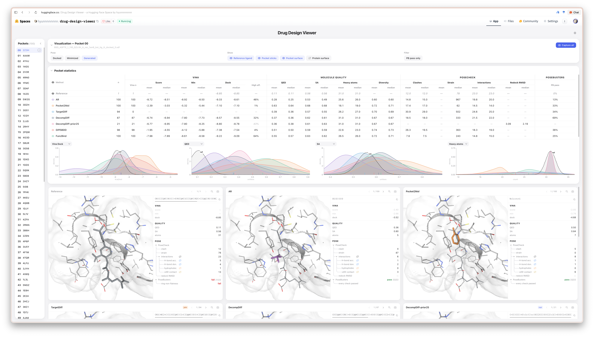

<p align="center">
  <picture>
    <source media="(prefers-color-scheme: dark)" srcset="figures/assets/code-logo-dark.svg">
    
  </picture>
</p>

# Blending Experimental Electron Density Information to Protein-Ligand Interaction

[](https://arxiv.org/abs/XXXX.XXXXX)

Official implementation of **CoDE**, a **Co**ordinate and **D**ensity **E**ncoder pre-trained on experimental electron-density maps.


Each binding site is a 3D voxel grid of atomic occupancy, experimental electron density and its gradient magnitude. A channel-wise vision transformer learns to reconstruct masked channels on about 100K [PLINDER](https://github.com/plinder-org/plinder) complexes. The frozen encoder is evaluated on binding-affinity regression and on pocket-conditioned ligand generation with [VoxBind](https://arxiv.org/abs/2405.03961), the codebase this repository grew from.

## Tasks

| Task | Data | Evaluation |
|---|---|---|
| Pretraining | PLINDER 2024-06/v2 without the proteins of every test set below (`CoDE_pretrain_v1`) | masked reconstruction |
| Binding-affinity regression | [LP-PDBBind](https://github.com/THGLab/LP-PDBBind) complexes with a [PDBe](https://www.ebi.ac.uk/pdbe/) density map, ligand and pocket RSCC ≥ 0.8, Kd/Ki only: 3,850 / 817 / 1,320 | frozen encoder + MLP probe, Pearson r, Spearman ρ, RMSE |
| Ligand generation | [CrossDocked2020](https://doi.org/10.1021/acs.jcim.0c00411) with the [TargetDiff](https://arxiv.org/abs/2303.03543) split | Vina, QED, SA, diversity, PoseCheck and PoseBusters on the 79 test pockets with a density map |

Affinity test sets:

| Test set | Complexes | Definition |
|---|---|---|
| FULL | 1,320 | test split of `lp_edrscc_v2` |
| CL3 | 733 | test split of the LP-PDBBind CL1–3 cleaned split |
| CL3-ID60 | 454 | CL3 test complexes below 60% sequence identity to the training proteins |
| CL3-ID30 | 262 | CL3 test complexes below 30% sequence identity to the training proteins |
| CASF-nontrain | 124 | [CASF-2016](https://doi.org/10.1021/acs.jcim.8b00545) core complexes outside the training split |
| CASF-clean | 92 | CASF-2016 core complexes outside the training and validation splits |

`CoDE_pretrain_v1` removes every PDB entry of these test sets and of the CrossDocked test pockets, and every protein whose sequence matches one of theirs ([DIAMOND](https://github.com/bbuchfink/diamond), 100% identity over at least 80% of the shorter sequence).

## Results

### Evaluation

| Tool | Version | Env (python) | What it produces |
|---|---|---|---|
| [AutoDock Vina](https://github.com/ccsb-scripps/AutoDock-Vina) | 1.2.2 | `voxeval` (3.10) | `score_only`, `minimize` and `dock` affinities (kcal/mol) |
| [PoseCheck](https://github.com/cch1999/posecheck) | 1.3.1 | `voxeval` (3.10) | steric clashes, UFF strain energy, ProLIF interaction profile |
| [PoseBusters](https://github.com/maabuu/posebusters) | 0.6.5 | `voxeval` (3.10) | validity in `dock` mode (20 graded checks) |

### Drug Design Viewer

**[huggingface.co/spaces/hyunnnnnnnn/drug-design-viewer](https://huggingface.co/spaces/hyunnnnnnnn/drug-design-viewer)** shows generated ligands pocket by pocket, one per method, with their Vina, QED/SA and PoseCheck/PoseBusters numbers.



## Repository Layout

```
CoDE/
├── voxbind/                     shared library: models, voxelization, frozen data splits
├── dataset/                     data loaders and the staged build pipeline (data in dataset/data/, not in git)
├── pretrain/                    encoder pretraining
├── task1-affinity_regression/   affinity probes, fine-tuning and evaluations
├── task2-ligand_generation/     VoxBind training, sampling and the evaluation package
├── base/                        external affinity baselines, one run script each
├── model_zoo/                   pretrained encoders and generators (weights not in git)
├── results/                     per-task metrics and reports (not in git)
├── web/                         Drug Design Viewer
├── env/                         pinned environments for docking and pose evaluation
└── script/                      environment setup and evaluation launchers
```

## Quick Start

```bash
# environments: voxbind (training) and voxeval (evaluation: Vina 1.2.2, PoseCheck, PoseBusters)
bash script/00_setup_env.sh
# or a container with both; env/Dockerfile's header has the run commands
docker build -f env/Dockerfile -t voxbind:env .

# binding affinity: pretrain an encoder and score it on the six test sets, from one config
python task1-affinity_regression/run.py task1-affinity_regression/configs/ab7v2p1_clean.yaml

# pretrain an encoder only (presets: pretrain/configs/README.md)
bash pretrain/scripts/pretrain.sh --experiment cdg_v2_champion --gpus 0-3

# ligand generation: train, sample, evaluate
cd task2-ligand_generation
CUDA_VISIBLE_DEVICES=0,1,2,3 python train.py smooth_sigma=0.9
python sample.py pretrained_path=exps/exp_sig0.9 wjs.split=val wjs.n_samples_per_pocket=10 wjs.n_targets=100
cd .. && SAMPLE_DIR=task2-ligand_generation/exps/<run>/samples/<sampling> bash script/05_evaluate.sh
```

The data build is described in `dataset/build/README.md`, and `python base/baseline.py --list` lists the affinity baselines.

## License

The code is Apache License 2.0 (`LICENSE.txt`), as is the upstream VoxBind. The exceptions are `task2-ligand_generation/evaluation/targetdiff/`, vendored from TargetDiff (MIT), and the two `reconstruct.py` files (`voxbind/utils/`, `evaluation/targetdiff/utils/`), which come from liGAN through TargetDiff and are GPL-2.0. Datasets, methods and tools keep their own terms.

**Data**

| Data | Used for | License |
|---|---|---|
| [PLINDER](https://github.com/plinder-org/plinder) 2024-06/v2 | pretraining corpus | Apache-2.0 (PLINDER-curated), CC BY 4.0 (BindingDB-curated), CC BY-SA 4.0 (ChEMBL-imported) |
| [wwPDB](https://www.wwpdb.org) structures, [PDBe](https://www.ebi.ac.uk/pdbe/) density maps | coordinates and density channels | CC0-1.0 |
| [PDBbind](http://www.pdbbind.org.cn) v2020, [CASF-2016](https://doi.org/10.1021/acs.jcim.8b00545) | affinity labels, CASF test sets | PDBbind+ user agreement: registration required, no redistribution |
| [LP-PDBBind](https://github.com/THGLab/LP-PDBBind), with BDB2020+ | affinity splits, temporal test | UC Regents academic license; BDB2020+ affinities from [BindingDB](https://www.bindingdb.org) (CC BY 4.0) |
| [CrossDocked2020](https://doi.org/10.1021/acs.jcim.0c00411) v1.1, [TargetDiff](https://github.com/guanjq/targetdiff) split | generation training and test pockets | none stated for the dataset |
| [MISATO](https://github.com/t7morgen/misato-dataset) | structural probe targets | CC BY 4.0 |
| ChEMBL35–PLINDER30 | external affinity test | CC BY-SA 3.0 ([ChEMBL](https://www.ebi.ac.uk/chembl/)) |
| [CASP16](https://zenodo.org/records/16762332) ligand affinities | external affinity test | CC BY 4.0 |
| [OpenBind](https://zenodo.org/records/20026661) EV-A71 2A | external affinity test | CC0-1.0 |

**Methods**

| Method | Role | License |
|---|---|---|
| [VoxBind](https://github.com/prescient-design/voxbind) | generative core: walk-jump sampling, voxel denoiser | Apache-2.0 |
| [TargetDiff](https://github.com/guanjq/targetdiff) | generation baseline; docking, QED/SA and diversity evaluation code | MIT |
| [liGAN](https://github.com/mattragoza/liGAN) | bond reconstruction from generated atoms | GPL-2.0 |
| [DiffSBDD](https://github.com/arneschneuing/DiffSBDD), [Pocket2Mol](https://github.com/pengxingang/Pocket2Mol), [AR](https://github.com/luost26/3D-Generative-SBDD) | generation baselines | MIT |
| [DecompDiff](https://github.com/bytedance/DecompDiff) | generation baseline | CC BY-NC 4.0 |
| [FuncBind](https://arxiv.org/abs/2511.15906) | generation baseline, macrocycle pilot | Apache-2.0 |
| [CheapNet](https://github.com/hyukjunlim/CheapNet), [ProFSA](https://github.com/bowen-gao/ProFSA), [IPDiff/IPNet](https://openreview.net/forum?id=qH9nrMNTIW), [GET](https://github.com/THUNLP-MT/GET), [DSMBind](https://github.com/wengong-jin/DSMBind), [GeoSSL](https://github.com/chao1224/GeoSSL) | affinity baselines | MIT |
| [AEV-PLIG](https://github.com/oxpig/AEV-PLIG), [DeepPurpose](https://github.com/kexinhuang12345/DeepPurpose) (DeepDTA, MolTrans) | affinity baselines | BSD-3-Clause |
| [Nesso-1](https://github.com/recursionpharma/nesso) | affinity baseline, open weights | Apache-2.0 |
| [BindNet](https://github.com/fengshikun/BindNet) | affinity baseline, retrained here | none declared |
| [HBGSA](https://arxiv.org/abs/2604.23115), [HonestAffinity](https://arxiv.org/abs/2606.03422) | our reimplementations, no upstream code | Apache-2.0 (this repository) |

**Tools** (installed as dependencies, not included)

| Tool | Used for | License |
|---|---|---|
| [AutoDock Vina](https://github.com/ccsb-scripps/AutoDock-Vina) | docking | Apache-2.0 |
| [Meeko](https://github.com/forlilab/Meeko) | ligand preparation for Vina | LGPL-2.1 |
| [Open Babel](https://github.com/openbabel/openbabel) | bond perception, format conversion | GPL-2.0 |
| [RDKit](https://github.com/rdkit/rdkit) | chemistry, QED, SA | BSD-3-Clause |
| [PoseCheck](https://github.com/cch1999/posecheck) | clashes, strain energy, interactions | MIT |
| [PoseBusters](https://github.com/maabuu/posebusters) | pose validity checks | MIT |
| [DIAMOND](https://github.com/bbuchfink/diamond) | sequence search for decontamination | GPL-3.0 |
| [gemmi](https://github.com/project-gemmi/gemmi) | electron-density maps | MPL-2.0 |

## Citation

```bibtex
@article{park2026blending,
  title   = {Blending Experimental Electron Density Information to Protein-Ligand Interaction},
  author  = {Park, Seonghyun and Chen, Shuan and Choong, Jun Jin and Kuno, Noboru and Lee, Gyubok and
             Madhawa, Kaushalya and Ozawa, Keisuke and Shindo, Hikaru and Ahn, Sungsoo},
  journal = {arXiv preprint arXiv:XXXX.XXXXX},
  year    = {2026}
}
```
